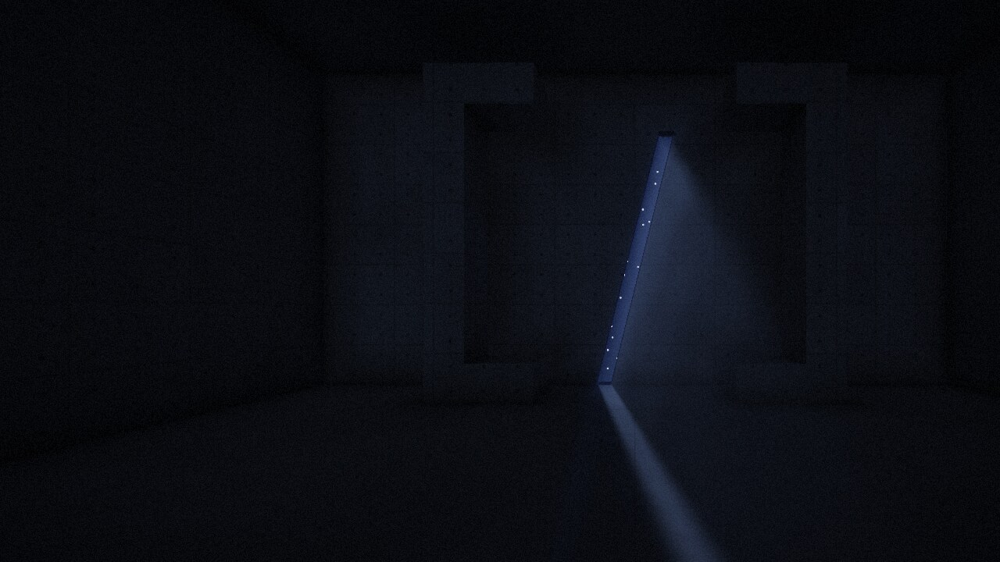
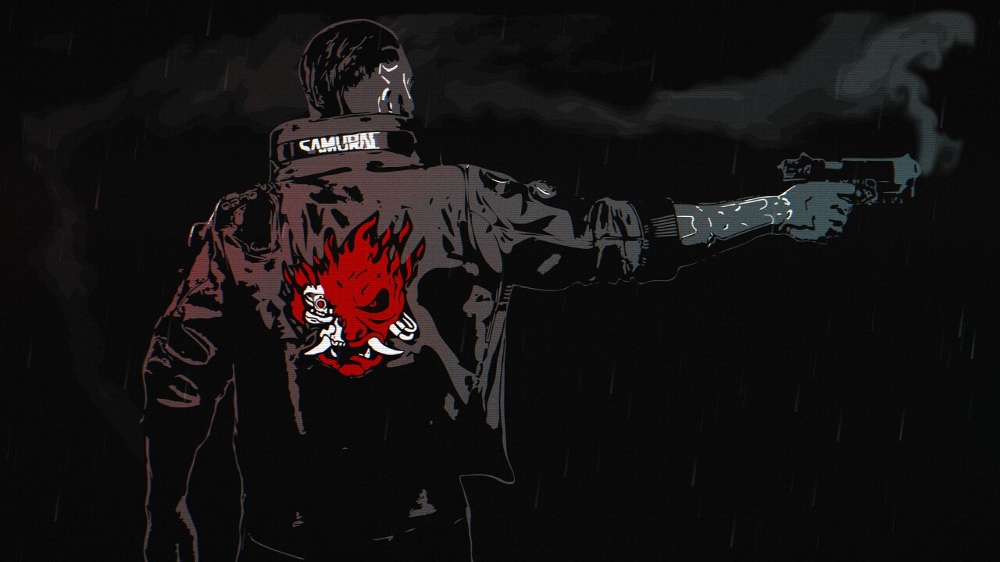

# Live Scenes

Live Scenes plays looping animated wallpapers ("looks") on **KDE Plasma 6, Android and macOS**. Each look is a seamless HEVC video loop, played with the hardware video decoder and paused whenever the wallpaper can't be seen, so it costs very little power. You browse looks from a catalog, preview one (downloaded temporarily), and save the ones you like as profiles; nothing else stays on disk. You can make your own looks from any video with the [SDK](#make-your-own-looks).

Get started: [Linux / KDE Plasma](#linux--kde-plasma) · [Android](#android) · [macOS](#macos) · [Make your own looks](#make-your-own-looks).

| Hall | Smoke Signal | Living Water |
| --- | --- | --- |
|  |  |  |
| [video (1080p)](docs/hall.webm) | [video (1080p)](docs/smoke-signal.webm) | [video (1080p)](docs/living-water.webm) |

**Hall**

https://github.com/user-attachments/assets/0b095001-25ac-4e0a-a24c-fdac912a55c8

**Smoke Signal**

https://github.com/user-attachments/assets/7aef2369-279a-4bae-8e18-d778011350b7

**Living Water**

https://github.com/user-attachments/assets/c4362d1e-b1f9-44e8-b46b-99c9e87d04bd






## The looks

- **Hall**: a concrete hall with a light slot in the wall, through one full day (daylight, golden hour, dusk, night, dawn) every 84 seconds.
- **Smoke Signal**: a figure illustration with fluid smoke curling off a gun muzzle, seen as a failing transmission: slice glitches, RGB split, neon washes, rain, scanlines and grain. On phones the whole picture is turned sideways so it fills the screen; it reads upright with the phone turned to landscape. The illustration is unofficial Cyberpunk 2077 fan art, used under CD PROJEKT RED's Fan Content Guidelines and not approved or endorsed by them. It is the only part of the project not under the MIT licence; see [ASSETS.md](ASSETS.md).
- **Living Water**: koi swimming under a water surface, with refraction, caustic light, ripple rings and drifting motes. It is built into the apps, so they show something before you download anything.
- **The Surge**: an ink-drawn boy wreathed in white fire, with floating rocks, rising dust and drifting ash.
- **Embers**: warm sparks lifting off the floor of a dark red forest.
- **Avenue Flow**: a city at dusk from above, with traffic streaming along a long avenue and twinkling lights. The twinkle has three strengths to choose from (Weak, Medium, Strong; Strong by default).
- **Night Wind**: an ink-drawn witch under the moon, her cape billowing as wind lines streak past.
- **Window Seat**: pixel art of a rainy city window at night; a black cat hops up onto the sill, watches the city for a while, stretches and wanders off along the desk. Phones get a closer layout of their own on the right side of the picture.
- **Circuit**: a circuit board that draws itself trace by trace behind small blue tracer lights, then lets them take it back.
- **Under the Wave**: a great wave builds and breaks over a little schooner, which capsizes, bobs keel-up, rights herself and sails on. Two options: Frame (Inside the circle, or Breaks out, with the wave and the ship leaving the circle) and Color (an Indigo or Seafoam theme on Android).

The looks were made once from animated web pages, which are kept in [`scenes-src/`](scenes-src/) as their source; `sdk/capture` records such a page frame by frame into a perfect loop for `livescenes pack`. The apps no longer render anything live.

## How it works on every platform

- **Catalog**: a `catalog.json` on this repository's latest GitHub Release lists the looks, with posters, sizes and checksums. Each app can be pointed at another catalog URL (Advanced settings).
- **Preview**: downloads only the video your device needs (landscape on desktops, portrait on phones) into the cache folder, checks its sha256 and plays it. Leave without saving and it is deleted.
- **Profiles**: "Save as profile" keeps the video. A profile is a look plus a speed: **0.5×, 1× or 2×**. Several profiles can share one video; it is deleted when the last profile using it is deleted. The profile in use can't be deleted.
- **Options**: a look can offer options, one row each in a profile's settings (Avenue Flow: Twinkle, Weak / Medium / Strong). The rows come from the look itself, so a new option needs no app update. Every combination of values is its own video; the saved look keeps only the chosen one. Changing an option downloads that video from the catalog and deletes the old one, for every profile of that look. Playback costs the same for every option: it is just another video.
- **Playback**: hardware HEVC decoding, a seamless loop, scaled to fill the screen and cropped around the look's focus point. Playback pauses while the wallpaper is hidden.
- **Themes**: every look comes with an Android theme, colors picked by hand to match it. On Android the phone's Material You colors follow the look (see [Theme](#theme)).

The formats (look pack, `scene.json`, catalog, storage folders) are specified in [`sdk/FORMAT.md`](sdk/FORMAT.md).

## Linux / KDE Plasma

### Requirements

- KDE Plasma 6, with `kpackagetool6` (package `kpackage`)
- Qt 6 Multimedia with its FFmpeg backend (`qt6-multimedia`, `qt6-multimedia-ffmpeg`); VA-API drivers for hardware decoding
- `curl` and `sha256sum` (used for downloads)

### Install

```
sudo pacman -S --needed git qt6-multimedia qt6-multimedia-ffmpeg
git clone https://github.com/jedbjorn/plasma-live-wallpapers.git
cd plasma-live-wallpapers
./install.sh
```

`install.sh` checks the requirements, adds the built-in Living Water look (from `build/packs/living-water/` if you made it with the SDK, otherwise downloaded from the latest release and checksummed), and installs the wallpaper for the current user under `~/.local/share/plasma/wallpapers/`. It needs no root.

To apply it: right-click the desktop, choose Configure Desktop and Wallpaper, set Wallpaper type to Live Scenes. The same page has the profiles (with their speed, and the options of a look that has them), the catalog and the preview. Wallpapers are configured per activity and per screen; each one can show a different profile.

Saved looks and `profiles.json` are in `~/.local/share/live-scenes/`, previews in `~/.cache/live-scenes/preview/`.

### Update and uninstall

The wallpaper's settings page looks for a newer release when you open it (at most once a day; "Check for updates" under Advanced asks right away). When there is one, **Update** downloads the plugin (about 20 KB), checks it and upgrades the installed package; your profiles, saved looks and the built-in look are kept. plasmashell keeps the old version loaded until it restarts, and the page says so: log out and back in, or run `systemctl --user restart plasma-plasmashell.service` when it suits you. Live Scenes never restarts the shell itself.

From a checkout:

```
git pull && ./install.sh --restart
```

`--restart` restarts plasmashell with the command above. Without it, the script never touches the shell.

`./uninstall.sh` removes the wallpaper and the preview cache, and tells you where your saved looks are. Pick another wallpaper type first if Live Scenes is in use.

### Efficiency and pausing

Measured on a 2560×1440 loop with an AMD integrated GPU: about 6% of one CPU core with VA-API decoding (33% with software decoding), 0% while paused. Playback pauses while a maximized or full-screen window covers that screen, and when the compositor stops drawing the desktop for 2 seconds (expected for the lock screen and screen-off; not yet checked on a live session).

### Other distros

Any Plasma 6 distribution should work with its packages for Qt 6 Multimedia (with the FFmpeg backend) and `kpackagetool6`. Package names have only been checked on Arch/CachyOS.

### Troubleshooting

- Black wallpaper: check `journalctl --user -b | grep -iE "livescenes|multimedia|ffmpeg"`, and that `/usr/lib/qt6/qml/QtMultimedia` exists.
- High CPU: hardware decoding isn't being used; check that your VA-API driver supports HEVC (`vainfo`).
- Changes not showing after an upgrade: restart plasmashell (`./install.sh --restart`).

## Android

The [`android/`](android/) folder holds the Live Scenes app: a live wallpaper plus the catalog, preview and profiles screens. It runs on Android 10 (API 29) or later. `android/build.sh` builds it with the Android SDK's own tools (`aapt2`, `javac`, `d8`, `apksigner`); there is no Gradle project.

### Set up the SDK (once)

Install a JDK 17 or later (CachyOS/Arch: `sudo pacman -S --needed jdk21-openjdk`). Download the [Android command-line tools](https://developer.android.com/studio#command-tools) and unzip them so that `~/Android/Sdk/cmdline-tools/latest/bin/sdkmanager` exists, then:

```sh
~/Android/Sdk/cmdline-tools/latest/bin/sdkmanager --licenses
~/Android/Sdk/cmdline-tools/latest/bin/sdkmanager platform-tools "build-tools;35.0.0" "platforms;android-35"
```

The build looks for the SDK in `$ANDROID_HOME`, then `~/Android/Sdk`. It bundles the Living Water look from `build/packs/living-water/` (made with the SDK; set `LIVESCENES_DEFAULT_PACK` to use another pack).

### Build and install

Connect the phone with USB debugging, or pair it once for wireless debugging (Settings > System > Developer options > Wireless debugging > Pair device with pairing code, then `adb pair <ip>:<port> <code>`). Then:

```sh
./android/build.sh --run
```

This builds `android/build/LiveScenes.apk` (version from the `VERSION` file; signed with the standard debug key, created in `~/.android/debug.keystore` if missing, or with a release key, see [Releasing](#releasing)), installs it, and opens the live wallpaper preview: tap Set wallpaper and choose Home screen and lock screen (one player serves both). `--install` installs without opening the preview.

In the Live Scenes app: browse the catalog, preview a look, save it as a profile, pick the active profile and its speed (and the options of a look that has them, such as Avenue Flow's Twinkle), and see how much storage your looks use. The wallpaper switches at once.

The app looks for a newer release when you open it (at most once a day; "Check for updates" under Advanced asks right away). **Update** downloads the release's APK, checks it and hands it to Android's installer, which asks you to confirm (the first time, also to allow Live Scenes to install apps). Profiles and saved looks are kept, and the wallpaper carries on with the new version. Android only installs an update signed with the same key as the app you have: a copy you built yourself can't be updated to the released one in place, and the app tells you so.

From a checkout, run `git pull && ./android/build.sh --install`. To uninstall, choose another wallpaper, then uninstall Live Scenes like any other app. Saved looks are excluded from Android backups.

### Efficiency

The wallpaper decodes the video with the phone's hardware decoder straight onto the wallpaper surface; it doesn't use the GPU unless a look needs an off-centre crop of the other orientation. Measured with the Pixel 6's on-device power meters, the Hall look on the home screen costs about **3 mAh per hour** over a hidden wallpaper, against about 114 mAh per hour for the earlier version that rendered the scene live. It uses nothing while hidden.

**Low battery:** below a battery level you choose in the app (Battery > Still frame below: 25%, 50% or 75%; 50% by default), the wallpaper shows a still image of the look and shuts the video player down completely: no decoder, no thread, no GPU work after the one frame is drawn. It plays again while charging, or once the battery is back at or above that level.

### Theme

Every look ships an Android theme: a hand-picked seed color (plus two alternatives, and a Material You style that suits it) that Android builds the phone's theme from. With **Theme > Match the phone's theme to the look** on (the default), the wallpaper gives Android the look's theme instead of colors picked from its picture; off, Android picks them from the picture as before.

Android applies a live wallpaper's new colors **the next time the screen turns off**: SystemUI takes one color change after a wallpaper is set, and defers later ones until the screen is off, so switching profiles changes the theme after you next lock the phone. To change it at once, grant Live Scenes the right to write the system theme setting, once, over adb:

```sh
adb shell pm grant com.designsos.livescenes android.permission.WRITE_SECURE_SETTINGS
```

Then **Change it at once, in the look's color style** appears under Theme. It writes the look's seed color and style into the setting that Android's Wallpaper & style uses (`theme_customization_overlay_packages`); your own value is saved first and put back when you turn the option off, turn matching off, or choose another wallpaper. It leaves the setting alone while you use a preset color from Wallpaper & style. Turn the option off before revoking the permission (`adb shell pm revoke …`), or the app can't put your setting back.

When the catalog loads, saved looks get their theme from it, without downloading the video again.

### Keeping the phone awake while developing

- Plugged in: Developer options > Stay awake, or `adb shell svc power stayon true` (`false` to undo).
- On battery: while wireless debugging is on, the app shows a Developer section with "Keep the screen on while wireless debugging is on". It works while Live Scenes is the wallpaper and stops when wireless debugging is turned off.

In both cases the power button still turns the screen off.

### Tested on Android

Tested on a Pixel 6 with Android 17: playback and seamless looping, speed presets, live profile switching, the catalog, preview download with sha256 check, save and discard, import from the SDK, look themes (deferred to screen off by SystemUI; applied at once with the secure-settings permission, and the setting restored exactly), look options (from a local catalog: Avenue Flow's Twinkle and a test look with two video options and a theme option; a saved look got its options when the catalog loaded, each change downloaded only that variant's video, deleted the old one and switched the wallpaper at once, an update kept the chosen variant, and a theme option changed only the colors, with no download), and the low-battery still (switching between still and playing on battery level and charger, simulated with `adb shell dumpsys battery`). Pausing with an app in front was measured at 0% CPU. Pausing with the screen off and playback on the lock screen use the same code path but have not been checked separately with the video version. Other devices have not been tested.

## macOS

The [`macos/`](macos/) folder holds the Live Scenes menu-bar app. It runs on macOS 13 or later and builds with `swiftc` (no full Xcode needed):

```sh
xcode-select --install          # once
./macos/build.sh --run
```

This builds `LiveScenes.app`, installs it to `~/Applications` and starts it. The build bundles the Living Water look from `build/packs/living-water/` if you made it with the SDK (set `LIVESCENES_DEFAULT_PACK` to use another pack), otherwise it downloads it once from the latest release, checks its sha256 and keeps it in `macos/build/default/`.

The menu bar icon switches between your profiles, sets the active profile's speed, and has Pause/Resume and Open at Login. **Profiles and Catalog…** opens the Live Scenes window: browse the catalog, preview a look (it plays on your desktop right away), then **Save as Profile** or **Discard**; rename, re-speed or delete profiles, pick the options of a look that has them (such as Avenue Flow's Twinkle or Under the Wave's Frame; a change downloads only that video, for every profile of the look), and see how much storage your looks use. Closing the window while previewing discards the preview. The catalog URL can be changed under Advanced. `sdk/livescenes add` installs a look pack straight into the app's folder, and the app picks it up at once.

Every screen shows the same profile. One video player feeds all screens, decoded in hardware, scaled to fill each screen and cropped around the look's focus point.

Saved looks and `profiles.json` are in `~/Library/Application Support/LiveScenes/`, previews in `~/Library/Caches/LiveScenes/preview/`.

To update, run `git pull && ./macos/build.sh --run`. To uninstall, quit it from the menu, delete `~/Applications/LiveScenes.app`, and delete `~/Library/Application Support/LiveScenes/` if you don't want to keep your saved looks.

### Efficiency

Playback pauses while every screen's wallpaper is hidden (covered by windows or a full-screen app), while the displays sleep, and while the screen is locked or another user is active. The app does not keep the display awake. On an Apple M3 laptop (macOS 26.6, Living Water at 2560×1440), the app itself used about 1% of one core while playing and nothing measurable while covered or paused; hardware decoding runs in the system's video decoder service.

## Make your own looks

The SDK is one script, [`sdk/livescenes`](sdk/livescenes) (Python 3 and ffmpeg with libx265). It turns any video into a look pack: a Blender or After Effects render, AI video, phone footage, a screen capture.

```sh
sdk/livescenes pack render.mov -o packs/aurora --id aurora --title "Aurora" --author "Me" --license CC-BY-4.0
sdk/livescenes check packs/aurora              # format, encoding, checksums, loop seam, theme
sdk/livescenes theme packs/aurora --set '#5b8def,#f2c14e,#e85d75'   # its Android theme (no re-encoding)
sdk/livescenes add packs/aurora                # this desktop (Plasma, macOS)
sdk/livescenes add packs/aurora --android      # a phone over adb; open the app once to import it
sdk/livescenes catalog packs/* -o release/     # assets + catalog.json to host your own catalog
```

`pack` cuts the loop, makes it seamless with a crossfade, encodes the landscape (2560×1440) and portrait (1080×2400) videos around a focus point, and writes the poster and `scene.json`. For phones, a landscape picture can be cropped (`--portrait-focus`), supplied separately (`--portrait`), or turned sideways (`--portrait-rotate cw`). Run `sdk/livescenes <command> --help` for all options.

A look can offer options, like Avenue Flow's Twinkle: give them once with `--option 'Twinkle: weak, medium, strong*'` (repeat for more rows; `*` marks the default), render the loop once per combination of values, and pack each render into the same folder with `--variant <key>` (the value ids in option order joined with `-`, e.g. `strong` or `strong-heavy`). `check` wants every combination, and `catalog` publishes them; the apps draw one row per option and download only the variant the user picks. Avenue Flow's page renders its variants with `?twinkle=weak|medium|strong`.

**Every look ships an Android theme.** Design it by eye from the look: a primary color whose hue is recognisably the look's (Android makes its own tones of it, so a strong hue matters more than the exact shade), two alternatives, whether the look is dark, and optionally a style (`MONOCHROMATIC` for black-and-white looks). `sdk/livescenes theme PACK` suggests a start from the poster; `--set` writes it, `pack --theme` takes it too (and re-packing keeps the existing one). `check` fails without a theme, and `catalog` copies it into the catalog. The repository's looks keep theirs in `scenes-src/<id>/theme.json` (`sdk/livescenes theme build/packs/<id> --set scenes-src/<id>/theme.json`).

### Agent skill

[`skills/live-scene/SKILL.md`](skills/live-scene/SKILL.md) teaches an AI coding agent (for example Claude Code) to make a look with the SDK: inspect the source, choose the loop and focus, pack, check, look at the seam, and install. To use it with Claude Code, copy or link the folder into `~/.claude/skills/`:

```sh
ln -s "$PWD/skills/live-scene" ~/.claude/skills/live-scene
```

## Releasing

The apps read the catalog and their own updates from the latest GitHub release, so every release carries both.

1. Set the new version in `VERSION`, and the same in `package/metadata.json` (`Version`) and `package/contents/ui/Store.js` (`VERSION`); `release.sh` refuses to run if they differ.
2. Build the update files: `./release.sh` writes `live-scenes-plasma-<version>.tar.gz`, `LiveScenes-<version>.apk` and `update.json` (described in [`sdk/FORMAT.md`](sdk/FORMAT.md)) into `build/release/`. `--no-android` leaves the APK out; phones are then not offered that release.
3. Add the catalog to the same folder: `sdk/livescenes catalog build/packs/* -o build/release`. Every pack needs its Android theme (`sdk/livescenes check` fails without one; `catalog` warns). A theme change alone is a look-only change: re-upload `catalog.json` (`gh release upload v<version> build/release/catalog.json --clobber`); phones copy the new theme into their saved looks when the catalog loads.
4. Publish: `gh release create v<version> build/release/*`.

**The Android signing key.** Android refuses an update that isn't signed with the same key as the installed app. Make one release key, once, and keep the keystore and its password somewhere safe and backed up; if it is lost, nobody can update in place any more:

```sh
keytool -genkeypair -keystore ~/live-scenes-release.p12 -storetype PKCS12 -alias livescenes -keyalg RSA -keysize 4096 -validity 10000 -dname "CN=Live Scenes"
LIVESCENES_KEYSTORE=~/live-scenes-release.p12 ./release.sh
```

Without `LIVESCENES_KEYSTORE` the APK is signed with the build machine's debug key (`~/.android/debug.keystore`), which is fine for your own phone but ties releases to that one file. `android/build.sh` prints the SHA-256 of the key it signed with.

To try an update without publishing one: serve a folder made by `release.sh` (`python3 -m http.server`), then start the Plasma settings with `LIVESCENES_UPDATE_URL=http://127.0.0.1:8000/update.json` in the environment, or, for a debuggable Android build (`LIVESCENES_DEBUG=1 ./android/build.sh --install`), `adb reverse tcp:8000 tcp:8000` and `adb shell am start -n com.designsos.livescenes/.SettingsActivity --es updateUrl http://127.0.0.1:8000/update.json`. Builds made without `LIVESCENES_DEBUG` ignore that option.

## License

MIT, see [LICENSE](LICENSE): the code, and the images and videos we made (Hall, Living Water). The one exception is the Smoke Signal artwork, unofficial Cyberpunk 2077 fan content that isn't ours to license; see [ASSETS.md](ASSETS.md).

## Credits

The Hall scene comes from [designs-os.com](https://designs-os.com), by the same author.
