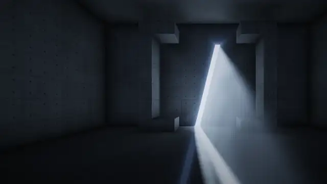
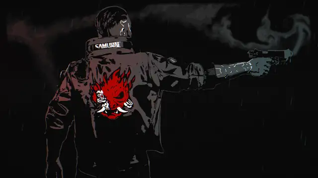
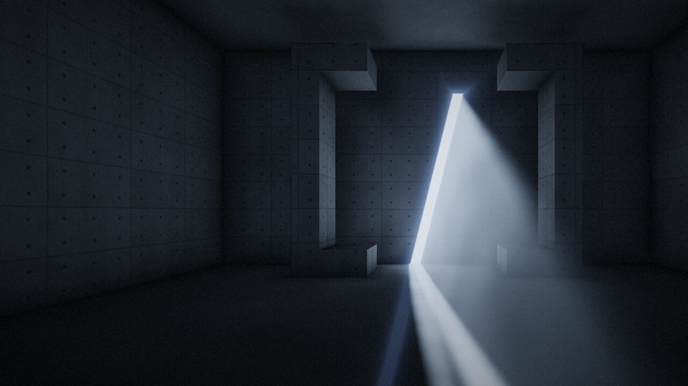
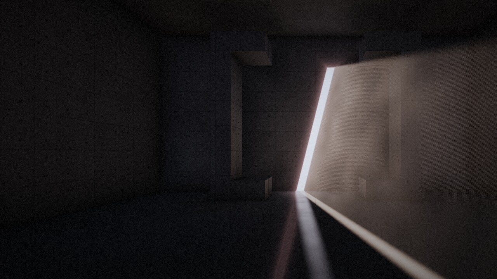
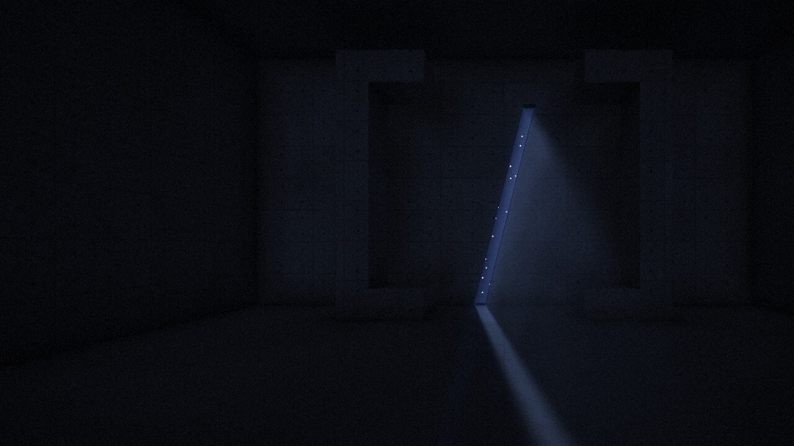
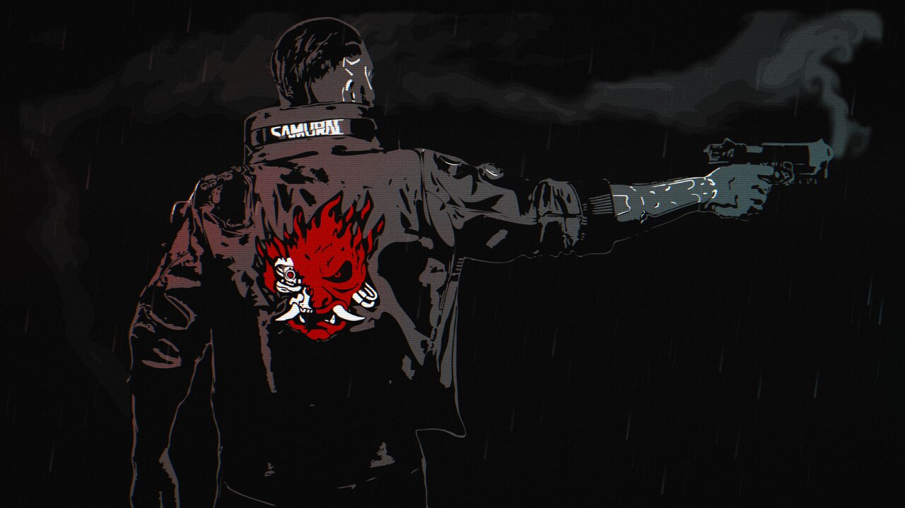
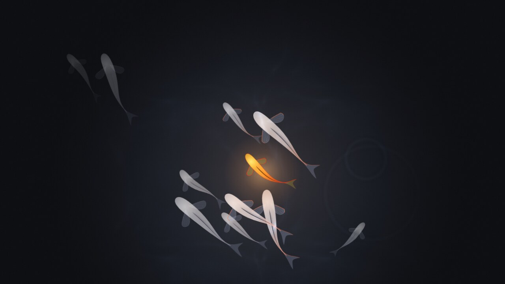

# Plasma Live Scenes

Live Scenes is a wallpaper plugin for KDE Plasma 6. It shows an animated scene as the desktop wallpaper. Each scene is a small local web page (plain WebGL2 or Canvas2D, no network access) rendered by Qt WebEngine inside a standard Plasma wallpaper package.

| Hall | Smoke Signal | Living Water |
| --- | --- | --- |
|  |  |  |
| [video](docs/hall.mp4) | [video](docs/smoke-signal.mp4) | [video](docs/living-water.mp4) |

The previews and videos are renders of the scene pages in headless Chromium, stepped frame by frame, not captures of a running desktop. The Hall video runs a whole day in 24 seconds; the default is 84.







## Scenes

### Hall

A raymarched concrete hall with a light slot in the wall. The light moves through a full day: daylight, golden hour, dusk, night and dawn. The scene either loops through one day every N seconds or follows the real clock. If WebGL2 is not available it falls back to a still image. Settings: Daylight (loop or real clock), One day lasts (seconds, loop mode only), Render resolution (%).

### Smoke Signal

A figure illustration with live fluid smoke curling off a gun muzzle, seen as a failing transmission: slice glitches, RGB split, neon washes, rain, scanlines and grain. Settings: Gun (whether the muzzle flash and smoke burst fire now and then).

The illustration is unofficial Cyberpunk 2077 fan art. It is not approved or endorsed by CD PROJEKT RED and is not covered by this repository's licence; see [ASSETS.md](ASSETS.md).

### Living Water

Procedurally drawn koi swimming under a water surface, with swell refraction, caustic light, ripple rings and drifting motes. Settings: Swim speed (%).

All scenes also have a Frames per second setting.

## Requirements

- KDE Plasma 6
- Qt 6 WebEngine (its QML module, `QtWebEngine`)
- A GPU and driver with WebGL2 support

Tested on CachyOS with Plasma 6.8, Qt 6.11/6.12, AMD Radeon integrated graphics, Wayland session. Nothing else has been tested.

## Install on CachyOS

Plasma itself is assumed to be installed. The QtWebEngine QML module is provided by `qt6-webengine`, and `kpackagetool6` by `kpackage` (already present with Plasma).

```
sudo pacman -S --needed git qt6-webengine
git clone https://github.com/jedbjorn/plasma-live-wallpapers.git
cd plasma-live-wallpapers
./install.sh
```

`install.sh` checks that `kpackagetool6` and the QtWebEngine QML module are present, then installs the package for the current user (under `~/.local/share/plasma/wallpapers/`). It needs no root.

To apply it: right-click the desktop, choose Configure Desktop and Wallpaper, set Wallpaper type to Live Scenes, and pick a Scene. Wallpapers are configured per activity and per screen, so repeat this for each one you want to change.

## Updating

```
git pull && ./install.sh --restart
```

`install.sh` upgrades an existing install. plasmashell keeps the old files loaded until it is restarted; `--restart` does that for you with `systemctl --user restart plasma-plasmashell.service`. Without `--restart` the script never touches the shell.

## Uninstall

```
./uninstall.sh
```

This runs `kpackagetool6 --type Plasma/Wallpaper --remove com.designsos.livescenes`. Pick another wallpaper type first if Live Scenes is in use.

## Other distros

Any Plasma 6 distribution should work if it has the package providing the QtWebEngine QML module and the package providing `kpackagetool6`. On Arch the package names are the same as on CachyOS (`qt6-webengine`, `kpackage`). Package names for other distributions have not been checked here.

## Settings reference

| Setting | Applies to | Range / values | Default |
| --- | --- | --- | --- |
| Scene | all | Hall, Smoke Signal, Living Water | Hall |
| Frames per second | all | 5 to 120 | 30 |
| Daylight | Hall | Loop through a day, Follow the real clock | Loop |
| One day lasts (seconds) | Hall, loop mode | 20 to 86400 | 84 |
| Render resolution (%) | Hall | 25 to 100 | 100 |
| Gun | Smoke Signal | on / off | on |
| Swim speed (%) | Living Water | 10 to 400 | 100 |

## Performance notes

- The frame cap defaults to 30 fps. Each scene page renders continuously while the session is active; a scene pauses only when the page reports itself hidden.
- To reduce GPU use, lower Frames per second, and for Hall lower Render resolution.
- Hall also steps its own quality and then its render resolution down if frames are consistently late.

## Adding a scene

1. Create a folder under `package/contents/web/<name>/` with an `index.html`. The page must read `?fps=` from its query string and cap its frame rate accordingly.
2. Add an entry to the `model` list in `package/contents/ui/config.qml` with the display text and the folder name as `value`.
3. If the scene needs its own options, add entries to `package/contents/config/main.xml`, matching `cfg_` properties in `config.qml`, and append the query parameters in `main.qml`.

The pages are loaded from `file://`, so:

- use classic scripts (`<script src="...">`), not ES modules;
- do not use `fetch` or XHR for local files;
- if you need images as WebGL textures, embed them as data URIs.

Scene pages can be opened in a normal browser for development, e.g. `package/contents/web/hall/index.html?tod=0.33` (Hall accepts `tod` from 0 to 1 to pin the time of day) or `package/contents/web/living-water/index.html?t=120` (Living Water accepts `t` as a start time in seconds).

## Troubleshooting

- Black wallpaper: check the log with `journalctl --user -b | grep -i webengine`. Also confirm the QtWebEngine QML module exists at `/usr/lib/qt6/qml/QtWebEngine` and that your driver provides WebGL2.
- Changes not showing after an upgrade: restart plasmashell with `systemctl --user restart plasma-plasmashell.service`.

## License

The code is MIT licensed, see [LICENSE](LICENSE).

The images and videos are not covered by that licence, see [ASSETS.md](ASSETS.md).

## Credits

The Hall shader comes from [designs-os.com](https://designs-os.com), by the same author.
