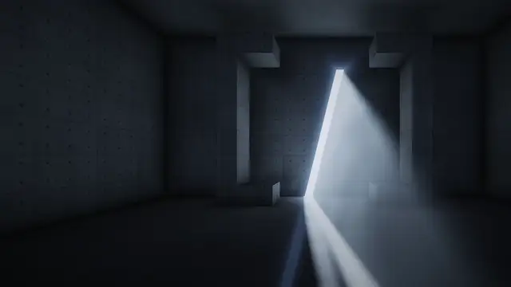
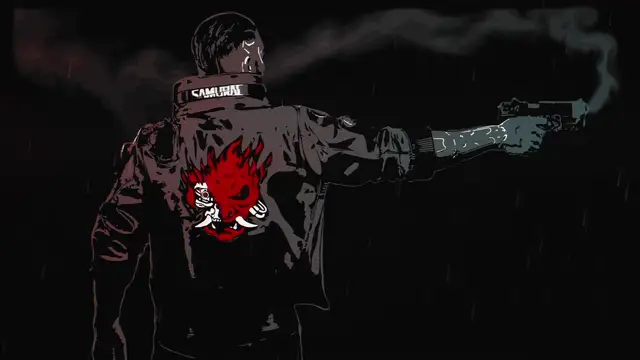
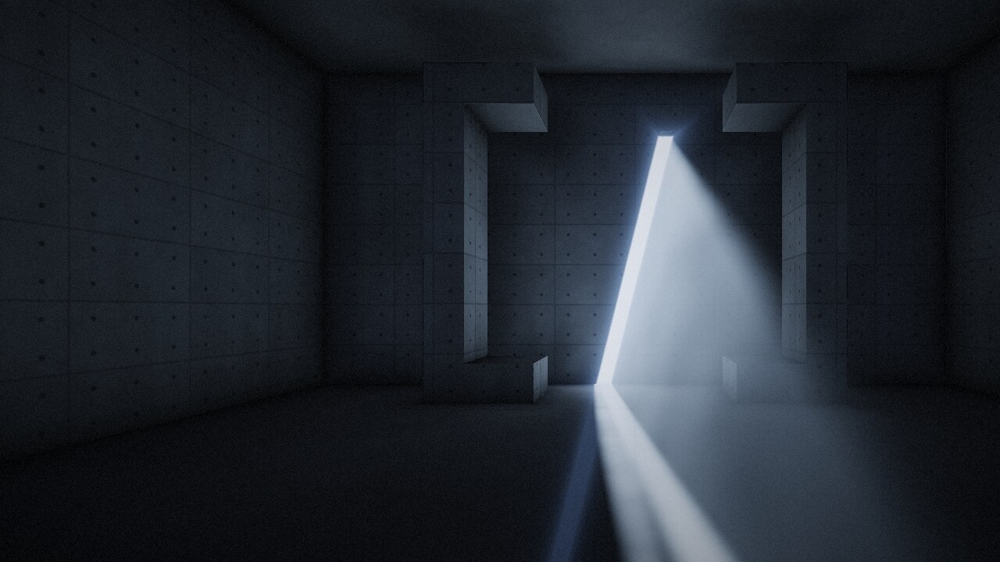
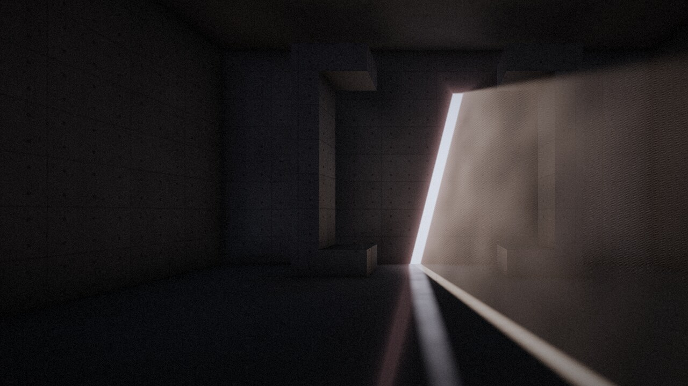
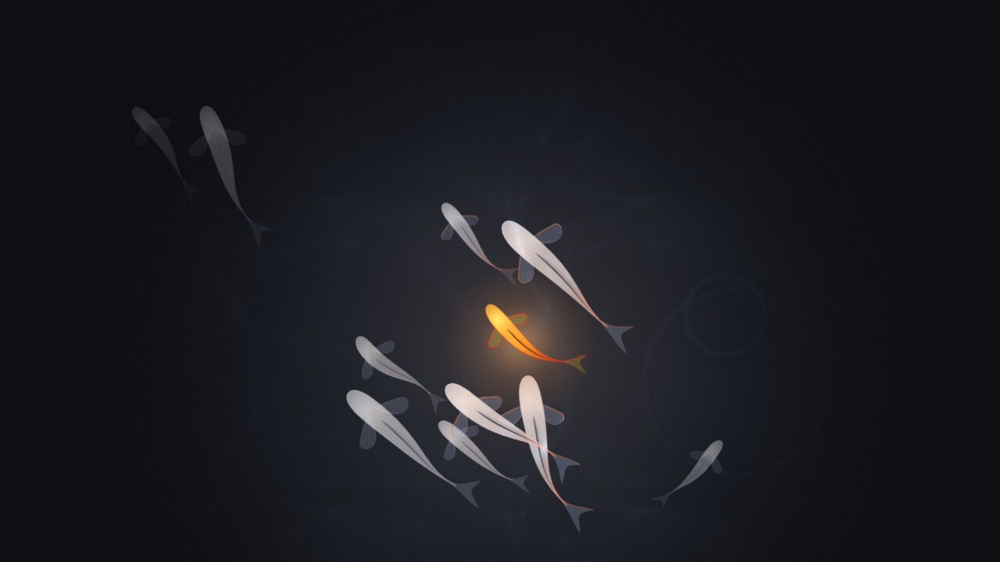

# Live Scenes

Live Scenes plays looping animated wallpapers ("looks") on **KDE Plasma 6, Android and macOS**. Each look is a seamless HEVC video loop, played with the hardware video decoder and paused whenever the wallpaper can't be seen, so it costs very little power. You browse looks from a catalog, preview one (downloaded temporarily), and save the ones you like as profiles; nothing else stays on disk. You can make your own looks from any video with the [SDK](#make-your-own-looks).

Get started: [Linux / KDE Plasma](#linux--kde-plasma) · [Android](#android) · [macOS](#macos) · [Make your own looks](#make-your-own-looks).

| Hall | Smoke Signal | Living Water |
| --- | --- | --- |
|  |  |  |
| [video (1080p)](docs/hall.webm) | [video (1080p)](docs/smoke-signal.webm) | [video (1080p)](docs/living-water.webm) |

**Hall**

https://github.com/user-attachments/assets/0b095001-25ac-4e0a-a24c-fdac912a55c8

**Smoke Signal**

https://github.com/user-attachments/assets/7aef2369-279a-4bae-8e18-d778011350b7

**Living Water**

https://github.com/user-attachments/assets/c4362d1e-b1f9-44e8-b46b-99c9e87d04bd







## The looks

- **Hall**: a concrete hall with a light slot in the wall, through one full day (daylight, golden hour, dusk, night, dawn) every 84 seconds.
- **Smoke Signal**: a figure illustration with fluid smoke curling off a gun muzzle, seen as a failing transmission: slice glitches, RGB split, neon washes, rain, scanlines and grain. On phones the whole picture is turned sideways so it fills the screen; it reads upright with the phone turned to landscape. The illustration is unofficial Cyberpunk 2077 fan art, not approved or endorsed by CD PROJEKT RED and not covered by this repository's licence; see [ASSETS.md](ASSETS.md).
- **Living Water**: koi swimming under a water surface, with refraction, caustic light, ripple rings and drifting motes. It is built into the apps, so they show something before you download anything.

The looks were made once from animated web pages, which are kept in [`scenes-src/`](scenes-src/) as their source. The apps no longer render anything live.

## How it works on every platform

- **Catalog**: a `catalog.json` on this repository's latest GitHub Release lists the looks, with posters, sizes and checksums. Each app can be pointed at another catalog URL (Advanced settings).
- **Preview**: downloads only the video your device needs (landscape on desktops, portrait on phones) into the cache folder, checks its sha256 and plays it. Leave without saving and it is deleted.
- **Profiles**: "Save as profile" keeps the video. A profile is a look plus a speed: **0.5×, 1× or 2×**. Several profiles can share one video; it is deleted when the last profile using it is deleted. The profile in use can't be deleted.
- **Playback**: hardware HEVC decoding, a seamless loop, scaled to fill the screen and cropped around the look's focus point. Playback pauses while the wallpaper is hidden.

The formats (look pack, `scene.json`, catalog, storage folders) are specified in [`sdk/FORMAT.md`](sdk/FORMAT.md).

## Linux / KDE Plasma

### Requirements

- KDE Plasma 6, with `kpackagetool6` (package `kpackage`)
- Qt 6 Multimedia with its FFmpeg backend (`qt6-multimedia`, `qt6-multimedia-ffmpeg`); VA-API drivers for hardware decoding
- `curl` and `sha256sum` (used for downloads)

### Install

```
sudo pacman -S --needed git qt6-multimedia qt6-multimedia-ffmpeg
git clone https://github.com/jedbjorn/plasma-live-wallpapers.git
cd plasma-live-wallpapers
./install.sh
```

`install.sh` checks the requirements, adds the built-in Living Water look (from `build/packs/living-water/` if you made it with the SDK, otherwise downloaded from the latest release and checksummed), and installs the wallpaper for the current user under `~/.local/share/plasma/wallpapers/`. It needs no root.

To apply it: right-click the desktop, choose Configure Desktop and Wallpaper, set Wallpaper type to Live Scenes. The same page has the profiles, the catalog and the preview. Wallpapers are configured per activity and per screen; each one can show a different profile.

Saved looks and `profiles.json` are in `~/.local/share/live-scenes/`, previews in `~/.cache/live-scenes/preview/`.

### Update and uninstall

```
git pull && ./install.sh --restart
```

plasmashell keeps the old files loaded until it restarts; `--restart` does that with `systemctl --user restart plasma-plasmashell.service`. Without it, the script never touches the shell.

`./uninstall.sh` removes the wallpaper and the preview cache, and tells you where your saved looks are. Pick another wallpaper type first if Live Scenes is in use.

### Efficiency and pausing

Measured on a 2560×1440 loop with an AMD integrated GPU: about 6% of one CPU core with VA-API decoding (33% with software decoding), 0% while paused. Playback pauses while a maximized or full-screen window covers that screen, and when the compositor stops drawing the desktop for 2 seconds (expected for the lock screen and screen-off; not yet checked on a live session).

### Other distros

Any Plasma 6 distribution should work with its packages for Qt 6 Multimedia (with the FFmpeg backend) and `kpackagetool6`. Package names have only been checked on Arch/CachyOS.

### Troubleshooting

- Black wallpaper: check `journalctl --user -b | grep -iE "livescenes|multimedia|ffmpeg"`, and that `/usr/lib/qt6/qml/QtMultimedia` exists.
- High CPU: hardware decoding isn't being used; check that your VA-API driver supports HEVC (`vainfo`).
- Changes not showing after an upgrade: restart plasmashell (`./install.sh --restart`).

## Android

The [`android/`](android/) folder holds the Live Scenes app: a live wallpaper plus the catalog, preview and profiles screens. It runs on Android 10 (API 29) or later. `android/build.sh` builds it with the Android SDK's own tools (`aapt2`, `javac`, `d8`, `apksigner`); there is no Gradle project.

### Set up the SDK (once)

Install a JDK 17 or later (CachyOS/Arch: `sudo pacman -S --needed jdk21-openjdk`). Download the [Android command-line tools](https://developer.android.com/studio#command-tools) and unzip them so that `~/Android/Sdk/cmdline-tools/latest/bin/sdkmanager` exists, then:

```sh
~/Android/Sdk/cmdline-tools/latest/bin/sdkmanager --licenses
~/Android/Sdk/cmdline-tools/latest/bin/sdkmanager platform-tools "build-tools;35.0.0" "platforms;android-35"
```

The build looks for the SDK in `$ANDROID_HOME`, then `~/Android/Sdk`. It bundles the Living Water look from `build/packs/living-water/` (made with the SDK; set `LIVESCENES_DEFAULT_PACK` to use another pack).

### Build and install

Connect the phone with USB debugging, or pair it once for wireless debugging (Settings > System > Developer options > Wireless debugging > Pair device with pairing code, then `adb pair <ip>:<port> <code>`). Then:

```sh
./android/build.sh --run
```

This builds `android/build/LiveScenes.apk` (signed with the standard debug key, created in `~/.android/debug.keystore` if missing), installs it, and opens the live wallpaper preview: tap Set wallpaper and choose Home screen and lock screen (one player serves both). `--install` installs without opening the preview.

In the Live Scenes app: browse the catalog, preview a look, save it as a profile, pick the active profile and its speed, and see how much storage your looks use. The wallpaper switches at once.

To update, run `git pull && ./android/build.sh --install`. To uninstall, choose another wallpaper, then uninstall Live Scenes like any other app. Saved looks are excluded from Android backups.

### Efficiency

The wallpaper decodes the video with the phone's hardware decoder straight onto the wallpaper surface; it doesn't use the GPU unless a look needs an off-centre crop of the other orientation. Measured with the Pixel 6's on-device power meters, the Hall look on the home screen costs about **3 mAh per hour** over a hidden wallpaper, against about 114 mAh per hour for the earlier version that rendered the scene live. It uses nothing while hidden.

### Keeping the phone awake while developing

- Plugged in: Developer options > Stay awake, or `adb shell svc power stayon true` (`false` to undo).
- On battery: while wireless debugging is on, the app shows a Developer section with "Keep the screen on while wireless debugging is on". It works while Live Scenes is the wallpaper and stops when wireless debugging is turned off.

In both cases the power button still turns the screen off.

### Tested on Android

Tested on a Pixel 6 with Android 17: playback and seamless looping, speed presets, live profile switching, the catalog, preview download with sha256 check, save and discard, and import from the SDK. Pausing with an app in front was measured at 0% CPU. Pausing with the screen off and playback on the lock screen use the same code path but have not been checked separately with the video version. Other devices have not been tested.

## macOS

The [`macos/`](macos/) app is being moved to the video format. Until then it still renders the scenes live from `scenes-src/` and works as before:

```sh
xcode-select --install          # once
./macos/build.sh --run
```

It builds with `swiftc` (no full Xcode needed), installs `LiveScenes.app` to `~/Applications` and launches it. Use the menu bar icon to choose a scene and its settings, Pause or Resume, and enable Open at Login. To uninstall, quit it from the menu and delete `~/Applications/LiveScenes.app`. Tested on macOS 26.6 with an Apple M3 and a single display.

## Make your own looks

The SDK is one script, [`sdk/livescenes`](sdk/livescenes) (Python 3 and ffmpeg with libx265). It turns any video into a look pack: a Blender or After Effects render, AI video, phone footage, a screen capture.

```sh
sdk/livescenes pack render.mov -o packs/aurora --id aurora --title "Aurora" --author "Me" --license CC-BY-4.0
sdk/livescenes check packs/aurora              # format, encoding, checksums, loop seam
sdk/livescenes add packs/aurora                # this desktop (Plasma, macOS)
sdk/livescenes add packs/aurora --android      # a phone over adb; open the app once to import it
sdk/livescenes catalog packs/* -o release/     # assets + catalog.json to host your own catalog
```

`pack` cuts the loop, makes it seamless with a crossfade, encodes the landscape (2560×1440) and portrait (1080×2400) videos around a focus point, and writes the poster and `scene.json`. For phones, a landscape picture can be cropped (`--portrait-focus`), supplied separately (`--portrait`), or turned sideways (`--portrait-rotate cw`). Run `sdk/livescenes <command> --help` for all options.

### Agent skill

[`skills/live-scene/SKILL.md`](skills/live-scene/SKILL.md) teaches an AI coding agent (for example Claude Code) to make a look with the SDK: inspect the source, choose the loop and focus, pack, check, look at the seam, and install. To use it with Claude Code, copy or link the folder into `~/.claude/skills/`:

```sh
ln -s "$PWD/skills/live-scene" ~/.claude/skills/live-scene
```

## License

The code is MIT licensed, see [LICENSE](LICENSE).

The images and videos are not covered by that licence, see [ASSETS.md](ASSETS.md).

## Credits

The Hall scene comes from [designs-os.com](https://designs-os.com), by the same author.
